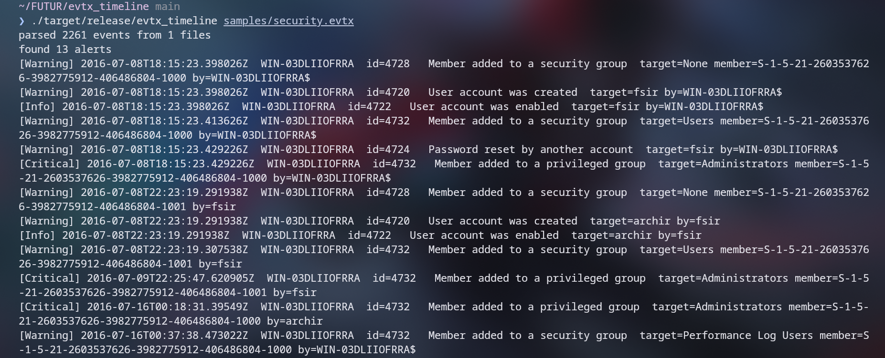

<table>
<tr>
<td width="340" valign="middle">


</td>
<td valign="middle">

# M3RICK


</td>
</tr>
</table>


---

## Open Source Contributions

**exfatprogs** · Linux exFAT filesystem utilities · fuzzed with libFuzzer and UBSan, two bugs found on crafted disk images

<table>
<tr>
<td width="50%" valign="top">

**1 · Undefined-behaviour shift in boot sector parsing**

A crafted boot sector triggers an out-of-range shift in the shared library used by five of the tools. I wrote the fix; the maintainer reviewed and merged it.

<a href="https://github.com/exfatprogs/exfatprogs/commit/f976d4d0b033e72518fb67f1d805fd49f2aebd95"></a>

[PR #403](https://github.com/exfatprogs/exfatprogs/pull/403) · [commit f976d4d](https://github.com/exfatprogs/exfatprogs/commit/f976d4d0b033e72518fb67f1d805fd49f2aebd95) · [write-up (PDF)](https://github.com/M3RICK/WriteUps/blob/main/VulnResearch/exfatprogs/exfatprogs-WriteUp.pdf)

</td>
<td width="50%" valign="top">

**2 · Infinite loop in exfat2img**

A cyclic FAT chain on a crafted image makes exfat2img walk the same directory forever. Reported upstream with a reproducer; fix in progress.

<a href="https://github.com/exfatprogs/exfatprogs/pull/409"></a>

[PR #409](https://github.com/exfatprogs/exfatprogs/pull/409)

</td>
</tr>
</table>

Fuzzing harnesses: [M3RICK/exfatprogs-fuzzer](https://github.com/M3RICK/exfatprogs-fuzzer)

---

## Professional Experience

<table>
<tr>
<td>

### Neurofounders - Security & Technical Audit (Internship)
**Apr - Jul 2026 · 4 months**

- Conducted technical audits of a subscription media platform - product/UX, access control, privacy, and web performance
- Delivered 8 findings reports to the founder, each documenting the issue and a clear, actionable recommendation
- Translated technical risks into plain language for a non-technical decision-maker

<p>
  
  
  
</p>

</td>
</tr>
<tr>
<td>

### Continental Automotive (now Aumovio), Embedded Software Intern
**Aug - Dec 2024 · Toulouse · R&D Passive Safety & Sensoring**

- Wrote the C proof of concept for a new sensor on a Renesas RL78/F13, from board bring-up to validated features. Continental presented the product, [eRTS](https://www.continental.com/en/press/press-releases/20250603-sam-erts/), in June 2025
- Generated timed pulse patterns with hardware timers and prescalers; drove peripherals over SPI, I2C and UART
- Wrote toolchain setup and handover docs; the team then ran my code on the boards for their live lab tests

<p>
  
  
  
</p>

</td>
</tr>
</table>

---

## Cybersecurity & Research

<table>
<tr>
<td width="50%" valign="top">

**Security Research & Write-Ups**

HTB Sherlocks, a CVE analysis with Sigma and Suricata detection rules, and CTF machine write-ups.

<a href="https://github.com/M3RICK/WriteUps"></a>

</td>
<td width="50%" valign="top">

**Blue Team Labs Online**

Defensive security and digital forensics challenges.

<a href="https://blueteamlabs.online/public/user/0bd62aebf339f4cb519d5b"></a>

</td>
</tr>

<tr>
<td width="50%" valign="top">

**Cybersecurity Club @ Epitech**

Organized weekly CTF practice sessions (Root-Me, HackTheBox).

</td>
<td width="50%" valign="top">

**Bug Bounty & Conferences**

Took part in the WOCS'hACK 2025 bug bounty competition ([3 reports](https://github.com/M3RICK/WOCS_hACK2025)). Attended IoT pentesting workshops at Toulouse Hacking Convention (THC).

</td>
</tr>
</table>

---

## Featured Projects

### SysInternalsCase
**Windows 10 disk investigation and malware reverse engineering - write-up (PDF, 9 pages)**

A user downloads the SysInternals suite, nothing opens, and the machine slows down. From the E01 image alone: PowerShell had turned off Defender and pointed `www.sysinternals.com` to a local server in the `hosts` file, the fake download installed a service running as SYSTEM, and Ghidra shows that service deleting every Prefetch file each second. The USN journal still recorded 214 of those deletions.

<p>
  <a href="https://github.com/M3RICK/WriteUps/blob/main/Ashemery/SysInternalsCase/SysInternalsCase-WriteUp.pdf"></a>
</p>

### evtx_timeline
**Windows Event Log forensic tool - Rust**

DFIR tool that parses `.evtx` logs into a normalized, chronologically sorted timeline and flags suspicious activity: per-EventID rules (log cleared, service install, privilege-group changes...) and a stateful brute-force detection. Unit tested.

<p>
  <a href="https://github.com/M3RICK/evtx_timeline"></a>
</p>



<sub><i>Real output on a sample Security.evtx - a sequence of account-creation events escalating to the local Administrators group, flagged by severity.</i></sub>

### Rift Rewind
**League of Legends match analysis with the Riot API and AI feedback - Python, AWS**

Prize winner at the AWS x Riot Games Hackathon 2025.

<p>
  <a href="https://devpost.com/software/jinx-s-workshop"></a>
  <a href="https://github.com/M3RICK/Jinx-s_Magical_Rewind_Machine"></a>
</p>

---

## Technical Stack

| | |
|:--|:--|
| **Languages** | C · C++ · Rust · Python · Haskell · x86 Assembly |
| **Forensics & Detection** | Windows Event Logs (EVTX) · Sysmon · Linux auth logs · Sigma · Suricata · MITRE ATT&CK |
| **Disk & Registry Forensics** | The Sleuth Kit · libewf (E01) · NTFS MFT & USN journal · regipy (hive log replay) · Prefetch · Amcache · UserAssist · BAM · SRUM · ESE (libesedb) · Eric Zimmerman tools |
| **Fuzzing & Debugging** | libFuzzer · AddressSanitizer · UBSan · Clang |
| **Network & Web** | Wireshark · Nmap · Burp Suite · Hydra · Chisel |
| **Embedded** | Renesas RL78 · SPI · I2C · UART |
| **Environment** | Linux · Exegol · Docker · Git · jq · Typst |
| **Malware Analysis** | Ghidra (static) · strings · VirusTotal |

---

## Background

```yaml
Nationality: French
Exchange:    Inha University, South Korea (2026-2027): Computer Networks, Operating Systems, IoT
Languages:   French (Native) · English (C1 IELTS) · German (Fluent) · Korean (Beginner)
```

---

## Connect

<p align="center">
  <a href="mailto:aymeric.lamanda@epitech.eu"></a>
  <a href="https://www.linkedin.com/in/aymeric-l-667657311/"></a>
</p>
