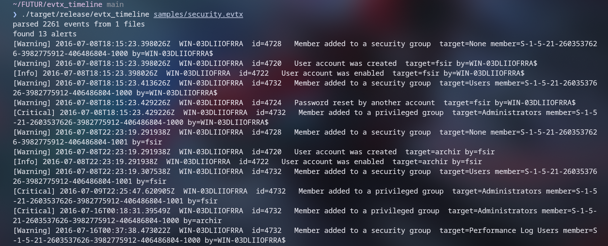

<table>
<tr>
<td width="340" valign="middle">


</td>
<td valign="middle">

# M3RICK

**Epitech Toulouse**
Cybersecurity • Digital Forensics • Reverse Engineering

<p>
  
  
  
</p>

<a href="https://github.com/M3RICK">
  
</a>

</td>
</tr>
</table>


---

## About

Student at Epitech Toulouse, focused on cybersecurity: **digital forensics (DFIR),
reverse engineering and low-level / systems programming**. I build security tooling
from scratch and practice on CTF and blue-team platforms. I came to reverse engineering through game integrity and
anti-cheat, which is still a side interest.

```yaml
Focus:             Digital Forensics (DFIR) · Reverse Engineering · Low-level / Systems
Currently Learning: Rust · Windows Internals · Binary Reverse Engineering
Exchange:          Inha University, Incheon, South Korea (2026-2027)
Languages:         French (Native) · English (C1 IELTS) · German (Fluent)
```

---

## Professional Experience

<table>
<tr>
<td>

### Neurofounders — Security & Technical Audit (Internship)
**Apr – Jul 2026 · 4 months**

- Conducted technical audits of a subscription media platform — product/UX, access control, privacy, and web performance
- Delivered 8 findings reports to the founder, each documenting the issue and a clear, actionable recommendation
- Translated technical risks into plain language for a non-technical decision-maker

<p>
  
  
  
</p>

</td>
</tr>
<tr>
<td>

### Continental Automotive (now Aumovio), Embedded Software Intern
**Aug – Dec 2024 · Toulouse · R&D Passive Safety & Sensoring**

- Wrote the C proof of concept for a new sensor on a Renesas RL78/F13, from board bring-up to validated features
- Generated timed pulse patterns with hardware timers and prescalers; drove peripherals over SPI, I2C and UART
- Wrote toolchain setup and handover docs; the team then ran my code on the boards for their live lab tests

<p>
  
  
  
</p>

</td>
</tr>
</table>

---

## Cybersecurity & Research

<table>
<tr>
<td width="50%" valign="top">

**Security Research & Write-Ups**

DFIR investigations (HTB Sherlocks), a CVE analysis with Sigma and Suricata detection rules, and CTF machine write-ups.

<a href="https://github.com/M3RICK/WriteUps">
  
</a>

</td>
<td width="50%" valign="top">

**Blue Team Labs Online**

Defensive security challenges and digital forensics investigations.

<a href="https://blueteamlabs.online/public/user/0bd62aebf339f4cb519d5b">
  
</a>

</td>
</tr>

<tr>
<td width="50%" valign="top">

**Cybersecurity Club @ Epitech**

Organized weekly CTF practice sessions (Root-Me, HackTheBox).

</td>
<td width="50%" valign="top">

**Bug Bounty & Conferences**

Took part in the WOCS'hACK 2025 bug bounty competition ([3 reports](https://github.com/M3RICK/WOCS_hACK2025)). Attended IoT pentesting workshops at Toulouse Hacking Convention (THC).

</td>
</tr>
</table>

---

## Featured Projects

### evtx_timeline
**Windows Event Log forensic tool — Rust**

DFIR tool that parses `.evtx` logs into a normalized, chronologically sorted timeline and flags suspicious activity: per-EventID rules (log cleared, service install, privilege-group changes...) and a stateful brute-force detection. Unit tested.

<p>
  
  
  
  &nbsp;
  <a href="https://github.com/M3RICK/evtx_timeline">
    
  </a>
</p>



<sub><i>Real output on a sample Security.evtx — a sequence of account-creation events escalating to the local Administrators group, flagged by severity.</i></sub>

**Other projects**

<table>
<tr>
<td width="33%" valign="top">

### GLaDOS
**Language & Compiler**

Compiler in Haskell: C-like syntax, type inference, bytecode compiler, custom VM, and a linker for multi-file compilation with relocatable object files.

<p>
  
  
</p>

<a href="https://github.com/M3RICK/GLaDOS">
  
</a>

</td>
<td width="33%" valign="top">

### Samuride
**Multiplayer game — custom binary protocol (C++)**

Client-server game in C++/SFML with a custom binary TCP protocol (typed message headers, state sync). My entry point into networking and anti-cheat / game integrity.

<p>
  
  
  
</p>

<a href="https://github.com/M3RICK/Samuride">
  
</a>

</td>
<td width="33%" valign="top">

### Rift Rewind
**AWS x Riot Games Hackathon — prize winner**

League of Legends analysis platform with Riot API integration and AI-driven feedback.

🏆 *Roast Master 3000 Prize — AWS x Riot Games Hackathon 2025*

<p>
  
  
</p>

<a href="https://github.com/M3RICK/Jinx-s_Magical_Rewind_Machine">
  
</a>

</td>
</tr>
</table>

---

## Technical Stack

<details>
<summary><b>Click to expand</b></summary>
<br>

**Languages**


**Security & Forensics**


**Learning / Familiar**


</details>

---

## Connect

<p align="center">
  <a href="mailto:aymeric.lamanda@epitech.eu">
    
  </a>
  <a href="https://github.com/M3RICK">
    
  </a>
  <a href="https://blueteamlabs.online/public/user/0bd62aebf339f4cb519d5b">
    
  </a>
</p>
